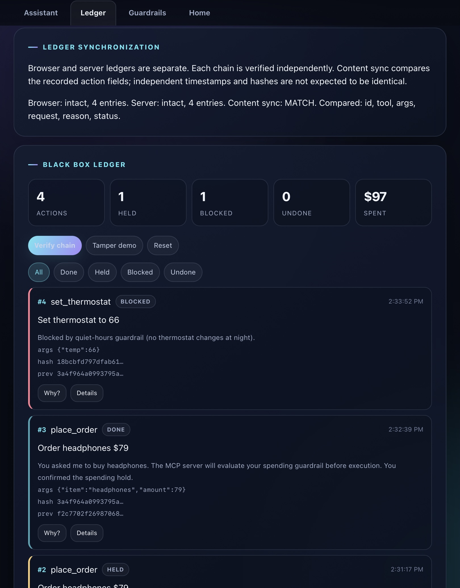
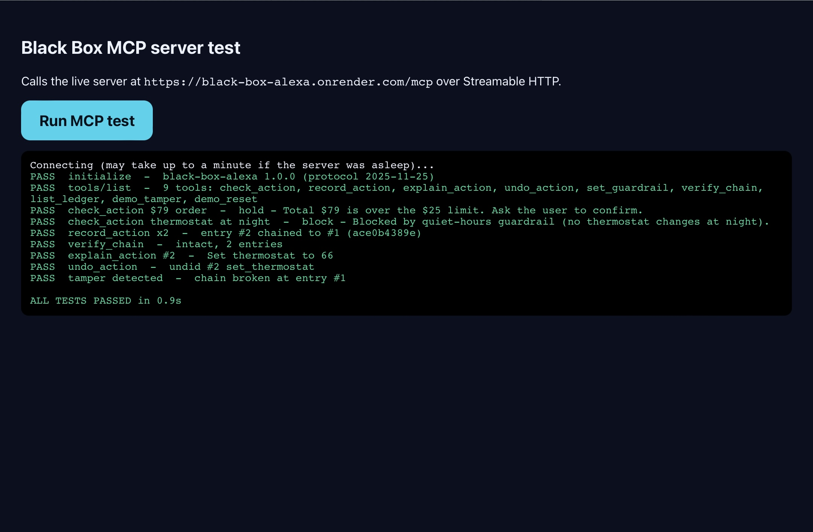

# Black Box for Alexa+

<p align="center">
  <strong>Make assistant actions visible, explainable, and auditable.</strong><br>
  A browser-based AI-assistant simulation + a live Model Context Protocol (MCP) server.
</p>

<p align="center">
  <a href="https://u19725505-star.github.io/black-box-alexa/"><strong>▶ OPEN LIVE DEMO</strong></a>
  &nbsp; · &nbsp;
  <a href="https://u19725505-star.github.io/black-box-alexa/mcptest.html"><strong>RUN MCP SMOKE TEST</strong></a>
  &nbsp; · &nbsp;
  <a href="https://black-box-alexa.onrender.com/health"><strong>SERVER HEALTH</strong></a>
</p>

<p align="center">
  
  
  
  
</p>

> **The idea:** Before an assistant acts, people should be able to see the decision. After it acts, they should be able to inspect the record. If the record is changed, the system should have a way to flag it.

Black Box for Alexa+ is an **experimental, non-operational prototype** exploring that interaction pattern. It pairs a polished browser experience with a deployed Node.js MCP server to demonstrate policy checks, user confirmation, action explanations, simulated undo, and hash-chain integrity checks. It is **not an integration with the real Amazon Alexa+ service** and does not operate real accounts, purchases, calendars, or devices.

---

## Demo video

[](https://www.youtube.com/watch?v=lWHUGFvwmRw)

**▶ [Watch the Black Box for Alexa+ demo on YouTube](https://www.youtube.com/watch?v=lWHUGFvwmRw)**

The video introduces the prototype. After watching, try the [live demo](https://u19725505-star.github.io/black-box-alexa/) and follow the [3–5 minute walkthrough](#try-the-live-demo-in-3–5-minutes).

---

## See it in action

### 1. The assistant experience

The web demo turns ordinary requests into visible policy decisions. Low-cost simulated actions can proceed, higher-cost actions can be held for confirmation, and restricted actions can be blocked with an explanation.



### 2. The MCP server test

The separate test page connects to the hosted MCP endpoint and exercises tool discovery, policy decisions, ledger recording, verification, explanation, undo, and intentional tamper detection.



The screenshots are captured demonstration evidence. The test page is a **manual smoke test**, not a comprehensive automated security assessment.

---

## Why this project matters

As assistants gain the ability to trigger actions, a useful interface needs to answer more than “Did it work?”

- **What was requested?**
- **What policy decision was made—and why?**
- **Was the action allowed, held, or blocked?**
- **What was written to the audit trail?**
- **Does the recorded history still verify?**
- **Can the user inspect or reverse a simulated action?**

Black Box makes these questions tangible in a small, runnable prototype. It explores a user-facing pattern for **action transparency** rather than claiming to solve trust or security for production assistants.

## Try the live demo in 3–5 minutes

**Start here:** [Open Black Box for Alexa+](https://u19725505-star.github.io/black-box-alexa/)

1. **Connect to MCP.** Tap **Connect to MCP server** and wait for the tool list. The free hosted service may need up to a minute to wake.
2. **Try an action under the threshold.** Enter `Order groceries $18`. In the default demo configuration, it should be allowed and recorded as `DONE`.
3. **Trigger a spending hold.** Enter `Order headphones $79`. With the default $25 limit, it should be marked `HELD` pending explicit confirmation.
4. **Confirm deliberately.** Type `confirm` to demonstrate the simulated confirmation flow. The history retains the held request and records the follow-up separately.
5. **Trigger a block.** In **Guardrails**, enable quiet hours and set simulated time to night. Try `Set thermostat to 66`; the policy should block it.
6. **Inspect the audit trail.** Open **Ledger** and tap **Verify chain**. Review the status, reason, and previous-hash information.
7. **Run the MCP checks.** Open the [MCP test page](https://u19725505-star.github.io/black-box-alexa/mcptest.html) and tap **Run MCP test**.

These are mock scenarios. No real order, device change, or calendar booking occurs.

### Recorded smoke-test evidence

In the captured MCP test run, the page reported **ALL TESTS PASSED in 1.1s**. The displayed checks included:

| Check | Observed result |
|---|---|
| MCP initialization | PASS |
| Tool discovery | 9 tools listed |
| $79 order policy | Held above the $25 demo limit |
| Thermostat at night | Blocked by the quiet-hours rule |
| Ledger recording and chaining | Two records chained in the test scenario |
| Chain verification | Intact before the tamper check |
| Explanation and undo | Passed in the test scenario |
| Tamper detection | Broken chain detected at entry #1 |

These results describe one captured manual smoke-test run; they are not a claim of exhaustive coverage, independent security review, or production reliability.

---

## How it works

```text
User enters a simulated request
              |
              v
       Browser experience
              |
              v
       MCP policy check
              |
       +------+------+ 
       |      |      |
     ALLOW   HOLD   BLOCK
       |      |      |
       |   Explicit   Explain
       |  confirmation decision
       +------+------+
              |
              v
     Simulated action record
              |
              v
      Hash-chained ledger
              |
              v
    Verify + explain + inspect
```

The app maintains **two separate ledgers**: one in the browser and one on the server. The Ledger panel verifies each chain independently, then compares selected logical fields—entry ID, tool, arguments, request, reason, and status. Because each side records independently, timestamps and hashes are not expected to be identical.

A synchronization result of `MATCH` means those compared fields agree and both chain checks passed at that moment. It is **not** proof of authenticated identity, identical cryptographic chains, durable storage, or production-grade tamper resistance.

## Features

- **Action guardrails:** simulated spending threshold and quiet-hours rules.
- **Explicit confirmation path:** over-threshold mock purchases are held before the user confirms.
- **Decision explanations:** view the request, status, reason, arguments, and hash-chain details.
- **Simulated undo:** inspect the undo workflow without connecting to external services.
- **Hash-chain verification:** entries include a hash and previous-hash link; verification can identify a modified record.
- **Intentional tamper demo:** changes a demo record so verification can demonstrate detection.
- **MCP over Streamable HTTP:** browser client connects to the hosted server, discovers tools, and calls them.
- **MCP traffic panel:** inspect recent calls, results, and durations.
- **Accessible status feedback:** connection and synchronization states are presented in the interface.
- **Responsive, static front end:** HTML, CSS, and JavaScript; no front-end build step required.

## MCP tools

The server currently exposes nine tools:

| Tool | Purpose |
|---|---|
| `check_action` | Evaluate a simulated action against current server guardrails. |
| `record_action` | Append an action record to the server ledger. |
| `explain_action` | Return details for a selected or recent record. |
| `undo_action` | Mark eligible server records as undone and return reversal targets. |
| `set_guardrail` | Change the server's demo guardrail settings. |
| `verify_chain` | Recompute and verify the server ledger's hash chain. |
| `list_ledger` | Read server records and current server guardrails. |
| `demo_tamper` | Intentionally alter a record to demonstrate detection. |
| `demo_reset` | Clear the server ledger and restore demo defaults. |

**Undo is not a real-world reversal.** The MCP tool reports which simulated records should be reversed; it does not control a real device or reverse an external transaction.

## Architecture and implementation

- **Frontend:** static HTML, CSS, and JavaScript hosted with GitHub Pages.
- **Backend:** Node.js 18+, Express, the official Model Context Protocol TypeScript SDK, and Zod.
- **Transport:** MCP Streamable HTTP at `POST /mcp`.
- **Health endpoint:** `GET /health`.
- **Hosting:** GitHub Pages for the web client; Render for the MCP service.
- **State:** the server ledger and guardrails are held in process memory and reset when the service restarts.

### Repository map

| Path | Responsibility |
|---|---|
| `index.html` | Page structure, tabs, and controls |
| `style.css` | Layout, responsive styling, and animation |
| `core.js` | Browser state, local simulated actions, ledger, hashing, and undo behavior |
| `main.js` | Command parsing, local decision flow, and event wiring |
| `ui.js` | UI rendering, ledger views, guardrails, and integrity controls |
| `mcp.js` | Browser MCP client, queued server calls, and traffic display |
| `ledger-sync.js` | Independent chain checks and logical content comparison |
| `server.js` | MCP server, tools, server ledger, guardrails, and HTTP endpoints |
| `mcptest.html` | Browser-based manual MCP smoke test |
| `demo-evidence/` | Screenshots of the website and MCP test results |
| `package.json` | Dependencies and start command |

## Run the MCP server locally

Requirements: **Node.js 18 or newer**.

```bash
npm install
npm start
```

By default, the server listens on port `3000` (or the `PORT` environment variable).

- MCP endpoint: `http://localhost:3000/mcp`
- Health check: `http://localhost:3000/health`

To connect the static front end to your local server, update the `MCP_URL` constant near the top of `mcp.js` to `http://localhost:3000/mcp`, then serve the static files through a local HTTP server. Do not open the HTML file directly from the filesystem.

## Security boundaries and limitations

This project is a **public hackathon demo**, not a production security product.

- **No real Alexa+ integration.** All actions are simulated. No Amazon account, retailer, calendar, or smart-home device is connected.
- **Public unauthenticated endpoint.** The hosted MCP server exposes state-mutating tools, including `record_action`, `set_guardrail`, `demo_tamper`, and `demo_reset`, without authentication. Anyone who can reach the endpoint may change shared demo state. CORS is not authentication.
- **Do not send sensitive data.** Never use this endpoint for personal information, secrets, real purchases, or real device commands.
- **In-memory state is temporary.** Server state can reset when Render restarts the service. The demo does not provide durable audit storage.
- **Approval is not cryptographically authenticated.** The server currently trusts an approval flag supplied by the caller; this is not a secure human-identity or consent protocol.
- **Independent ledgers can diverge.** The browser and server maintain separate records. Logical field comparison is useful for the demo but is not a distributed consistency guarantee.
- **Hash chains have a limited threat model.** They can detect edits to fields included in the fingerprint when verification is run, but do not prove who created a record or prevent an operator from rewriting the full ledger and recomputing hashes. The current server fingerprint does not include the separate `undone` flag.
- **Destructive test controls change shared state.** The MCP smoke test uses the demo tamper/reset tools. Do not run it while someone else is relying on the live demo state.
- **Speech recognition is not implemented.** Browser speech synthesis may read responses aloud, but input is typed.

### What production hardening would require

Before this concept could be considered for real services, it would need authenticated clients, server-side authorization, a trustworthy confirmation protocol, protected or removed destructive tools, durable append-only storage, complete integrity coverage for mutable fields, and independent security testing. Those capabilities are **not claimed by this prototype**.

## Roadmap

- [ ] Authenticate MCP clients and authorize each tool.
- [ ] Separate development-only tamper/reset tools from public deployments.
- [ ] Persist records in a durable store with explicit retention policy.
- [ ] Include every mutable field in integrity verification and test undo semantics.
- [ ] Add automated regression tests and repeatable CI results.
- [ ] Evaluate the UX with users and document usability findings.

## Project details

- **License:** MIT — see [LICENSE](LICENSE).
- **Live web demo:** https://u19725505-star.github.io/black-box-alexa/
- **MCP test page:** https://u19725505-star.github.io/black-box-alexa/mcptest.html
- **MCP endpoint:** https://black-box-alexa.onrender.com/mcp

<p align="center">
  <strong>See the decision. Understand the reason. Inspect the record.</strong>
</p>
